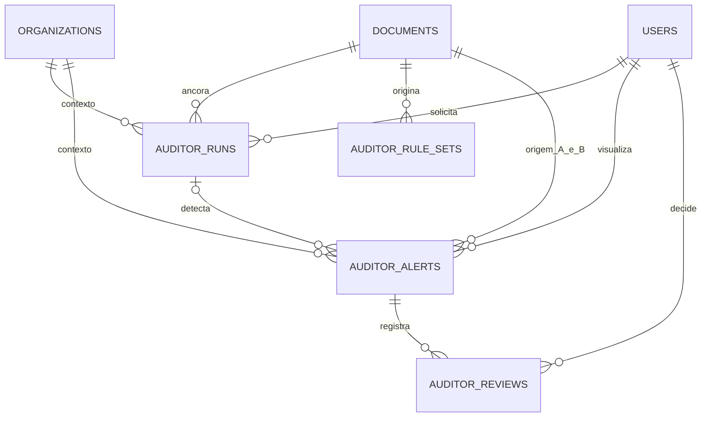

# AI-Up Auditor

O Auditor examina textos já extraídos pelo AI-Up e abre candidatos à revisão humana. Ele separa a classificação sugerida da decisão registrada pelo usuário. Uma divergência de valor, prazo ou redação só é apresentada dentro do escopo e das limitações da análise.

## Funcionamento

1. A auditoria manual parte de um documento pronto. O fluxo normal considera até 12 documentos ativos autorizados, priorizando mesma categoria e recência, e tenta obter a versão imediatamente anterior. A semelhança é verificada entre regras, após essa seleção. A comparação explícita aceita uma versão anterior da mesma família, incluindo arquivadas, quando ambos os documentos estão acessíveis. A família usa nome original, proprietário e organização.
2. Regras em português são extraídas de blocos com valores, percentuais, prazos, obrigações, proibições e vigências. São reconhecidos qualificadores declarados como assunto, departamento, público, responsável, condição, exceção e código de norma. Cada regra Pydantic contém evidência literal, versão, seção, deslocamentos no texto extraído e página, planilha ou rótulo quando disponível. Qualificadores ausentes ou datas inválidas são indicados na regra. Deslocamentos apontam para o texto extraído, inclusive em OCR.
3. Tipos, termos normalizados, alguns sinônimos, escopo, condições, unidades, limites mínimos/máximos e vigências determinam os candidatos. Um intervalo de valores compatível, uma exceção explícita, públicos claramente distintos ou períodos sem interseção podem excluir um candidato. Uma divergência plausível com condição ou unidade duvidosa pede esclarecimento. Uma validade expirada pode sinalizar desatualização. O sistema nunca marca um caso como confirmado por conta própria.
4. A comparação de versões busca equivalentes, registra alterações de valor, prazo, vigência ou qualificadores e indica regras sem equivalente na outra versão. A ausência de um equivalente é uma hipótese de adição ou remoção. Se uma versão não possui regras extraíveis, o resultado informa evidência insuficiente. Versões arquivadas só entram na comparação histórica autorizada.
5. Os resultados são persistidos após revalidar autorização, geração do índice e estado da fila. Alertas que perderam atualidade por substituição, reprocessamento ou término da vigência ficam na consulta de históricos. O estado da revisão humana permanece explícito.

Os limites por execução são 12 pares ativos, mais a versão anterior quando disponível, 180.000 caracteres e 80 regras por documento, e 250 alertas. Uma execução que atingiu limite relevante, ou cuja etapa vetorial opcional falhou, informa `PARTIAL`. `NO_INCONSISTENCY_IDENTIFIED` significa ausência de achados no escopo avaliado. `INSUFFICIENT_EVIDENCE` sinaliza que a comparação ficou sem regras de origem ou contraparte úteis, e `ALERTS_FOUND` indica candidatos disponíveis. Em operações que mudam de documento ou versão durante a execução, é preciso iniciar nova análise.

### Configuração

| Variável | Padrão | Efeito |
|---|---|---|
| `AUDITOR_AUTOMATIC` | `false` | Enfileira para o proprietário após indexação bem-sucedida. Ative no ambiente da aplicação para operação proativa. |
| `AUDITOR_SEMANTIC` | `false` | Com `EMBEDDING_PROVIDER=sentence_transformers`, usa o modelo de embeddings existente para corroborar candidatos lexicais de fronteira. |
| `AUDITOR_OLLAMA` | `false` | Com `LLM_PROVIDER=ollama`, pede uma opinião estruturada sobre escopo em até três casos de esclarecimento por execução. A classificação permanece a mesma. |

O modo padrão é determinístico e não precisa de LLM para auditar. No modo vetorial, a classificação usa somente embeddings de assuntos extraídos de documentos autorizados. No modo Ollama, apenas os trechos de evidência do candidato são enviados ao serviço local. A resposta é limitada a uma sugestão de escopo e convertida em texto fixo. Erros do provedor preservam o resultado determinístico e aparecem na diferença entre chamadas e sucessos na configuração da execução.

O worker de auditoria tem um executor separado com uma vaga. A fila tem limite de 4 solicitações ativas por usuário e 32 no processo. Uma solicitação repetida para o mesmo escopo, versões, data e configuração reutiliza a execução. Uma tentativa antiga não pode salvar resultados após cancelamento e reenvio. Na reinicialização, auditorias que estavam ativas são sinalizadas como interrompidas. O cliente pode enfileirá-las novamente. Cancelamento é cooperativo e pode aguardar o término de uma chamada local já iniciada.

## Dados e autorização

A migration `20261111_0007` adiciona quatro tabelas e índices. `auditor_runs` armazena execução, escopo interno, configuração, estado e progresso. `auditor_rule_sets` guarda regras por documento, geração do índice e versão do extrator, inclusive quando a lista está vazia. `auditor_alerts` guarda cada par documental, classificação, fingerprint e snapshots das evidências. `auditor_reviews` é a trilha de decisões com usuário, estado, justificativa e data. Eventos operacionais também são registrados na trilha existente, sem copiar os trechos ou a justificativa.

O usuário autenticado inicia e revisa suas próprias execuções e alertas. Compartilhar o documento não compartilha automaticamente o alerta nem concede aos administradores acesso ao texto privado. O SQL revalida a ACL de ambas as fontes antes de listar, detalhar, filtrar, registrar revisão ou exportar. A consulta ao original usa a autorização da biblioteca. Após revogação, o histórico e os trechos derivados ficam indisponíveis para o usuário que perdeu acesso. Se uma fonte é excluída, suas regras e alertas associados são eliminados em cascata, junto com as revisões desses alertas. Uma execução cuja contraparte foi excluída pode manter metadados internos, mas fica invisível. Arquivar conserva a evidência sob a ACL atual. Esta política do Auditor não altera a retenção de respostas antigas do chat.

## API

Rotas sob `/api/auditor`, com a mesma autenticação do resto da aplicação. Os recursos restritos respondem `404`. Arquivos fora do estado pronto ficam fora das análises. Consulte `/docs` na instância local para os esquemas completos.

| Método e rota | Resultado |
|---|---|
| `POST /runs` | `202`. Recebe `document_id` e, opcionalmente, `previous_document_id`. Retorna ID, estado, etapa, progresso e configuração. |
| `GET /runs` | Execuções recentes do usuário com escopo ainda autorizado. `offset` e `limit` de até 50. |
| `GET /runs/{id}` | Acompanha `queued`, `running`, `done`, `error` ou `cancelled`. |
| `POST /runs/{id}/cancel` | Cancela cooperativamente uma execução ativa. |
| `GET /alerts` | Lista paginada com `q`, `kind`, `state`, `include_historical`, `offset` e `limit` de até 100. |
| `GET /alerts/export` | Exporta em JSON os primeiros 100 resultados da página selecionada e informa total, limite e offset. Os mesmos filtros e ACL são aplicados. |
| `GET /alerts/{id}` | Detalhes, evidências e até 100 decisões recentes. |
| `GET /alerts/{id}/evidence` | Regras com trechos literais, versões e localizadores. |
| `POST /alerts/{id}/reviews` | Recebe `state` e `justification` de 3 a 1.000 caracteres. Registra decisão humana. |
| `GET /documents/{id}/versions` | Versões anteriores da família que o usuário ainda pode acessar, até 50. |
| `GET /documents/{id}/changes` | Alertas de comparação de versões do documento, paginados. |

Classificações: `POSSIBLE_CONTRADICTION`, `RELEVANT_CHANGE`, `POSSIBLE_OUTDATED` e `NEEDS_CLARIFICATION`. Estados humanos: `PENDING_REVIEW`, `CONFIRMED`, `FALSE_POSITIVE` e `RESOLVED`. Uma decisão repetida com a mesma justificativa imediatamente anterior não é duplicada. `PENDING_REVIEW` também permite reabrir um alerta.

## Estado da entrega

- **IMPLEMENTADO E TESTADO:** análise manual e automática, fila, cancelamento, deduplicação, versões, evidências, revisões, filtros, exportação, permissões, modos locais determinístico e assistido em casos sintéticos.
- **IMPLEMENTADO, MAS PENDENTE DE VALIDAÇÃO:** utilidade em documentação empresarial inédita, qualidade dos candidatos vetoriais e da opinião do Ollama em amostra cega.
- **PROPOSTO:** seleção mais ampla de documentos relacionados, normalização de unidades e datas por extenso, extração de regras entre anexos e política organizacional de retenção.
- **NÃO IMPLEMENTADO:** fila distribuída, compartilhamento de decisões entre usuários, arbitragem jurídica, declaração de conformidade e resolução automática.
