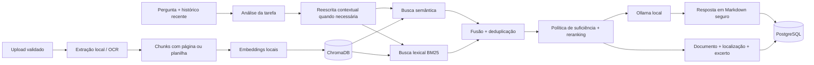

# Arquitetura RAG do AI-Up

## Visão geral

## Fluxo de uma pergunta

1. O analisador identifica a intenção. Uma pergunta explícita usa apenas seu próprio texto; uma continuação recebe até seis mensagens recentes, respeitando o limite de caracteres.
2. O mesmo `user_id` filtra a busca semântica e a busca lexical dentro do banco vetorial. O filtro ocorre antes da fusão, não apenas na interface.
3. A busca semântica recupera paráfrases. O BM25 preserva nomes, códigos, datas e números exatos.
4. Os resultados são combinados com peso configurável, deduplicados e reranqueados. Tarefas amplas favorecem páginas ou planilhas diversas.
5. A política de suficiência rejeita correspondências fracas. Sem contexto aceito, o provedor retorna a mensagem padronizada de informação insuficiente.
6. O modelo recebe somente os trechos selecionados, a instrução da tarefa e, quando necessário, o histórico. As fontes persistidas mostram o excerto que sustenta a resposta.

## Decisões de projeto

| Decisão | Justificativa |
|---|---|
| Heurísticas locais para intenção e continuidade | São rápidas, explicáveis e não adicionam custo ou outra chamada ao modelo. |
| Embeddings + BM25 | Combina significado com correspondência exata. |
| Reranking local | Melhora a ordem com baixa latência e sem serviço externo. |
| Ollama | Mantém documentos e prompts na máquina da apresentação. |
| PostgreSQL + ChromaDB | Separa dados relacionais/auditoria do índice vetorial. |
| Fontes estruturadas | Torna a resposta auditável por documento, página/planilha e excerto. |

## Segurança e isolamento

- chats, mensagens, documentos e feedback verificam o proprietário no backend;
- as duas rotas de recuperação aplicam `user_id` no ChromaDB;
- conteúdo de documentos é tratado como dado não confiável e não pode substituir as instruções do sistema;
- o frontend constrói Markdown com nós DOM e `textContent`, sem injetar HTML retornado pelo modelo;
- segredos permanecem nas variáveis de ambiente; logs de auditoria não registram senhas nem conteúdo integral dos documentos.

## Configuração de recuperação

Os principais controles são `RAG_CANDIDATE_POOL`, `RAG_SEMANTIC_WEIGHT`, `RAG_MIN_RELEVANCE`, `RAG_SEMANTIC_ONLY_MIN_RELEVANCE`, `RAG_BROAD_TOP_K` e `RAG_LEXICAL_SCAN_LIMIT`. Os padrões usados na avaliação estão no `.env.example`.
