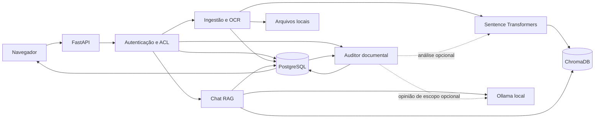

# Material para atualização do TCC — AI-Up

Texto-base para incorporar ao documento acadêmico conforme a estrutura e as referências já usadas pela instituição. Os números abaixo descrevem as execuções sintéticas registradas. Para discussão detalhada dos limites, consulte o [relatório experimental](AVALIACAO_AUDITOR.md) e o [relatório do RAG](RELATORIO_VALIDACAO_TCC.md).

## Problema e justificativa

Regulamentos, procedimentos, contratos e planilhas distribuem informações operacionais entre arquivos com escopos e datas de vigência diferentes. A consulta manual pode exigir localizar documentos, identificar versões, relacionar cláusulas e verificar se uma exceção se aplica. Uma diferença entre dois valores pode representar conflito, alteração de norma ou uma regra legítima para outro público. O trabalho propõe um ambiente local que ajude a localizar as fontes, responder perguntas fundamentadas e sinalizar possíveis divergências para revisão. A contribuição do Auditor é produzir candidatos com evidências localizáveis e trilha de decisão humana.

## Objetivos

**Objetivo geral.** Desenvolver e avaliar um sistema local de inteligência documental que combine consulta em linguagem natural e verificação de regras corporativas com controle de acesso e evidências rastreáveis.

**Objetivos específicos.** Extrair e indexar documentos com metadados de origem. Recuperar informações relevantes por busca vetorial e lexical. Gerar respostas contextualizadas com fontes. Estruturar regras com evidência literal. Detectar divergências potenciais e alterações de versão levando em conta escopo e vigência. Permitir que usuários autorizados revisem os resultados. Avaliar recuperação, geração, detecção, falhas e isolamento em experimentos reproduzíveis.

## Arquitetura e tecnologias

O sistema é uma aplicação monolítica modular, executada localmente com um processo Uvicorn. Python concentra os serviços de extração, recuperação e análise. FastAPI e Pydantic oferecem contratos de API, validação e documentação. SQLAlchemy e Alembic controlam o acesso relacional e as alterações de esquema. PostgreSQL preserva consistência dos relacionamentos e centraliza a autorização. ChromaDB armazena vetores para recuperação semântica. Sentence Transformers gera embeddings multilíngues e Ollama executa o modelo de linguagem no computador. O Tesseract complementa o texto digital quando OCR é necessário. A interface usa HTML, CSS e JavaScript e compartilha autenticação e componentes entre biblioteca, conversas e Auditor.

No banco relacional, usuários, organizações e equipes definem propriedade e compartilhamento. Sessões renováveis e convites utilizam credenciais persistidas em forma de hash. Documentos guardam versão, categoria, estado, seções extraídas e a geração ativa do índice. Conversas, mensagens, trabalhos de geração e fontes representam o histórico do RAG. O Auditor acrescenta execuções, conjuntos de regras por geração, alertas e revisões. O índice vetorial recebe somente os IDs autorizados para a operação. Os arquivos originais permanecem em armazenamento local e podem ser abertos pela interface sob autorização.

## Fluxo de ingestão e consulta

O upload valida formato e tamanho. A extração preserva páginas PDF, linhas ou planilhas e elementos de tabelas quando disponíveis. Em material escaneado, o OCR pode produzir lacunas ou erros e a saída extraída deve ser conferida no original. O chunking respeita limites do tokenizador e mantém sobreposição para reduzir perdas em fronteiras de trecho. Os embeddings formam uma geração de índice que só passa a ser usada após sucesso. Reprocessamentos com falha preservam a geração anterior.

O chat analisa a pergunta e o histórico autorizado para resolver referências. Filtra documentos pelo escopo, combina busca vetorial com BM25 e reordena os trechos antes da geração. O modelo é instruído a usar as evidências disponíveis. A resposta é exibida em streaming e recebe fontes para conferência. A validação de citações identifica referências inválidas e alguns erros literais. Histórico, exportação e retomada revalidam as dependências conhecidas. Cópias já exportadas dependem de governança fora do sistema. A API permite parar a geração e preservar a pergunta para nova tentativa.

## Método do Auditor documental

O Auditor trabalha sobre as seções persistidas após a extração. Identifica padrões de prazos, limites, percentuais, obrigações, proibições e vigência. Registra qualificadores explícitos de público, departamento, responsável, condição, exceção e código de norma. Uma regra validada contém versão, seção e deslocamentos do trecho textual. Ausências e datas inválidas são indicadas como incerteza. Para cada regra, o responsável pela revisão pode abrir a prévia e o original.

A comparação identifica candidatos semanticamente relacionados por normalização lexical e, opcionalmente, embeddings. Verifica tipos, unidades, qualificadores e sobreposição temporal antes de produzir alertas. O modo local assistido pode registrar uma opinião curta do Ollama em candidatos de esclarecimento. A opinião não muda a classificação do detector. Diferenças entre versões da mesma família geram alterações relevantes, incluindo regras sem equivalente localizado. Alertas anteriores podem aparecer como históricos quando a fonte é substituída, reprocessada ou deixa de estar vigente.

Na Central de Inconsistências, uma pessoa autorizada pesquisa alertas, confere as evidências, confirma a divergência, descarta um falso positivo, marca resolução ou reabre a revisão. Cada decisão guarda justificativa e data. As regras são reaproveitadas enquanto a geração do índice permanece válida. A fila é separada da geração do chat, com estados persistidos, limites, idempotência, cancelamento e recuperação após reinício. Documentos revogados ocultam resultados derivados. A exclusão elimina regras e alertas relacionados e as revisões correspondentes.

## Requisitos e casos de uso

| Requisito | Evidência nesta entrega |
|---|---|
| RF1 — Autenticar, organizar equipes e restringir leitura por ACL | Rotas de autenticação e administração e testes de isolamento |
| RF2 — Ingerir, versionar, pré-visualizar e reprocessar arquivos | Biblioteca, ingestão assíncrona, OCR e testes de recuperação |
| RF3 — Consultar documentos em linguagem natural com fontes | Chat RAG, exportação e testes com Ollama local |
| RF4 — Iniciar auditoria manual e opcionalmente após indexação | API de execução, progresso e testes de fila |
| RF5 — Detectar e classificar candidatos, comparar versões | Regras Pydantic, classificador determinístico e benchmark |
| RF6 — Conferir evidências e registrar revisão | Central, API de evidências, histórico e exportação |
| RNF1 — Operar localmente em Windows com isolamento dos dados | Ollama em loopback, banco local e execução de demonstração separada |
| RNF2 — Rastrear resultados até a origem e a configuração | Versão, página ou seção, trecho literal, modelo e parâmetros registrados |
| RNF3 — Limitar recursos e preservar estados em falhas | Filas limitadas, cancelamento e migração não destrutiva |
| RNF4 — Garantir reprodutibilidade | Fixtures versionadas, suites SQLite e PostgreSQL e relatórios brutos |

O caso de uso **Consultar documento** inicia com a seleção de arquivos autorizados e termina com uma resposta cujas evidências podem ser abertas. O novo caso de uso **Auditar documento** parte de um arquivo pronto, compara regras com contrapartes elegíveis e termina com alertas ou um resultado de escopo insuficiente. **Comparar versões** exige acesso às duas versões da mesma família. **Revisar alerta** exige acesso aos dois documentos e produz uma decisão registrada. **Exportar alertas** aplica os mesmos filtros e permissões no momento da exportação.

## Metodologia experimental, resultados e limites

Foram usados três conjuntos sintéticos para o Auditor, com 16 casos de desenvolvimento, 26 reservados e oito de estresse. Cada caso foi repetido cinco vezes sob data e configuração fixas. No conjunto reservado houve 15 tipos corretamente identificados, zero tipos espúrios e zero tipos esperados omitidos. As 30 evidências produzidas correspondiam a trechos localizáveis no texto. No estresse, apenas um de cinco achados esperados foi recuperado, com F1 de 0,333 e quatro falsos negativos em construções implícitas ou formatos não cobertos. Não houve alertas nos 11 casos negativos reservados nem nos três negativos de estresse. A estabilidade das repetições é uma propriedade deste modo determinístico e deste corpus.

Os testes integrados exercitaram as permissões de equipe, de organização e do proprietário, a revogação, a exclusão e as fontes originais. A medição em memória não representa a latência de ingestão, do banco, do OCR ou do modelo local. A amostra sintética favorece redações compatíveis com o extrator. Um conjunto cego de documentos inéditos, com dois avaliadores independentes, ainda precisa verificar a validade de conteúdo, a cobertura de condições e a utilidade para revisão. A execução local, os limites de candidatos e a ausência de coordenação distribuída também restringem conclusões de escala.

## Segurança e trabalhos futuros

O servidor aplica o controle de acesso fora dos modelos. Documentos e saída do modelo são tratados como dados não confiáveis. A aplicação aplica filtros e revalida a origem antes de entregar evidências. Backups e exportações precisam de controles de acesso e de guarda. A política de retenção futura deve definir prazos, responsabilidade e tratamento de cópias restauradas. Nenhum dos resultados sustenta afirmações sobre produtividade empresarial, conformidade integral ou ausência de alucinações. Entre os trabalhos futuros estão ampliar reconhecimento de números e datas por extenso, resolver referências a anexos, aumentar cobertura lexical e vetorial, medir carga em ambiente empresarial isolado e validar a revisão humana.

## Reproduzir a demonstração

No Windows, instale as dependências de acordo com o README e siga o [roteiro da banca](ROTEIRO_APRESENTACAO.md). A instância de demonstração cria banco e índice descartáveis, com conta e documentos sintéticos. Os contratos e o diagrama de entidades estão na [documentação do Auditor](AI_UP_AUDITOR.md). A análise humana e as métricas permanecem separadas dos resultados do chat.
